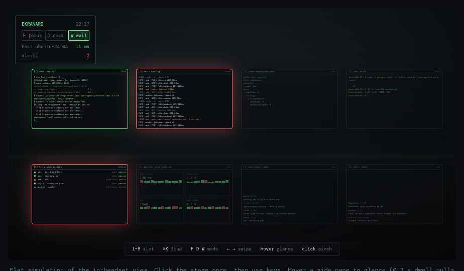
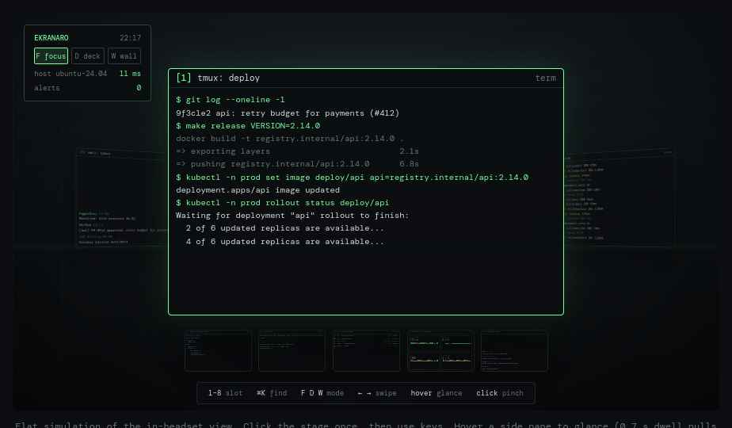
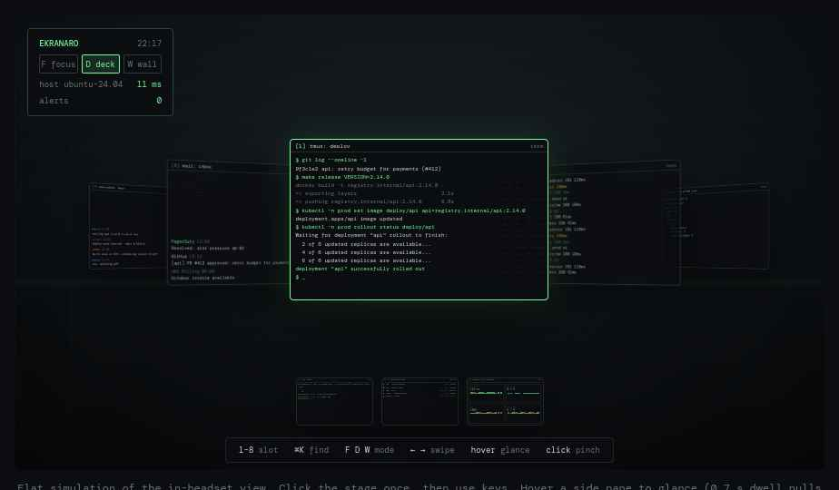

# Ekranaro

**An open-source DevOps cockpit for Meta Quest 3.** Your Ubuntu windows as numbered slots in space, three layouts to arrange them, and alerts that find you.

*ekran·aro* — Esperanto, "a set of screens".

> Status: **pre-alpha / design stage**. This repository holds the vision, plans and interactive mockups. No code yet — see [KICKOFF.md](KICKOFF.md) for how it starts.



- **Try the interactive prototype** — open `mockups/prototype.html` (or the GitHub Pages site, once enabled)
- **Vision deck** — `mockups/vision-deck.html` · text version in [docs/vision.md](docs/vision.md)
- **Plan and roadmap** — [docs/plan.md](docs/plan.md)
- **Design decisions** — [docs/decisions.md](docs/decisions.md)

## Why

Ops work is many small windows: terminals, SSH sessions, a log tail, a rollout status, CI, Grafana, chat. VR desktops today (Virtual Desktop, Immersed, Horizon Workrooms, WayVR, Stardust XR) stream monitors or screens into space. None of them know what a window, a hotkey or an alert is, and only the last two run from a Linux host.

Ekranaro treats each window as a slot, keeps switching on the keyboard, and adds a wall mode so you can watch everything at once and be pulled to what breaks.

## Modes

| Key | Mode | What you see |
|---|---|---|
| `F` | **Focus** | One slot large, previous and next angled at the sides, the rest in a dock. |
| `D` | **Deck** | Five slots in an arc at reading distance. Swipe or arrows rotate it. |
| `W` | **Wall** | Every slot on a wall, dimmed, except alerting ones. Pinch to acknowledge and focus. |

| Focus | Deck |
|---|---|
|  |  |

## Switching

| Input | Action |
|---|---|
| `Super+1…9` | jump to slot |
| `Super+K` | fuzzy finder over window titles |
| `F` · `D` · `W` · `Tab` | change or cycle mode |
| gaze 0.7 s | glance a side pane; dwell pulls it forward |
| pinch · swipe | pull a tile to focus · rotate the deck |

## Architecture

```
ekranaro-agent (Ubuntu 24.04, Rust)          ekranaro-quest (OpenXR, Quest 3)
  per-window capture  xdg-desktop-portal      hardware H.265 decode → Vulkan textures
  encode              H.265 VA-API / NVENC    slots · modes · dock · wrist panel
  input               libei / uinput          hand tracking · head-pose gaze · passthrough
  collectors          CI APIs · Prometheus    native panels: CI board · alert feed
  discovery           mDNS · QR pairing
                 ──── Wi-Fi 6E or USB-C · WebRTC/QUIC · ~10–20 ms ────
```

No PC-side VR runtime. The host streams windows and data; spatial logic runs on the headset.

## Roadmap

1. **Stream and type** — capture, Focus mode, keyboard and mouse passthrough
2. **Slots and modes** — hotkeys, finder, Deck, Wall, glance, pinch and swipe
3. **Alerts and native panels** — GitHub Actions, GitLab, Jenkins, Prometheus collectors
4. **Polish and distribution** — .deb and snap, App Lab, saved layouts, other OpenXR headsets

Details and phase timing in [docs/plan.md](docs/plan.md).

## Repository layout

```
README.md          this file
KICKOFF.md         how the project starts: goals, scope of v0.1, first milestones
docs/
  plan.md          roadmap and phase plans
  vision.md        vision deck, text version
  decisions.md     design decisions log
mockups/
  prototype.html   interactive flat simulation of the in-headset view
  vision-deck.html 13-slide vision deck
  readme-page.html landing-page mockup
  shots/           screenshots of the three modes
```

Planned code repos: `agent` (Ubuntu host), `quest` (OpenXR client) and `spec` (a short protocol document for slots, modes and alerts, so other clients and agents can follow it).

## Contributing

Good first issues once code lands: KDE Plasma per-window capture, VA-API path for Intel iGPUs, GitLab CI collector, shared log alert ruleset, left-handed wrist panel. Until then, open an issue to discuss the design or the spec.

## License

Apache-2.0 — see [LICENSE](LICENSE).
